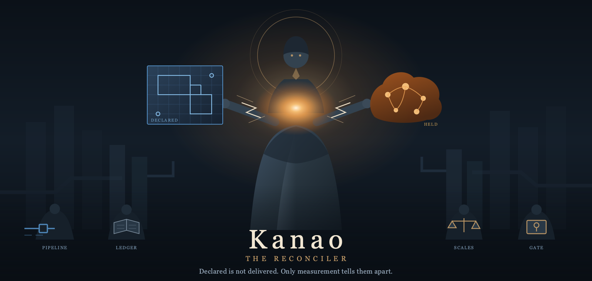
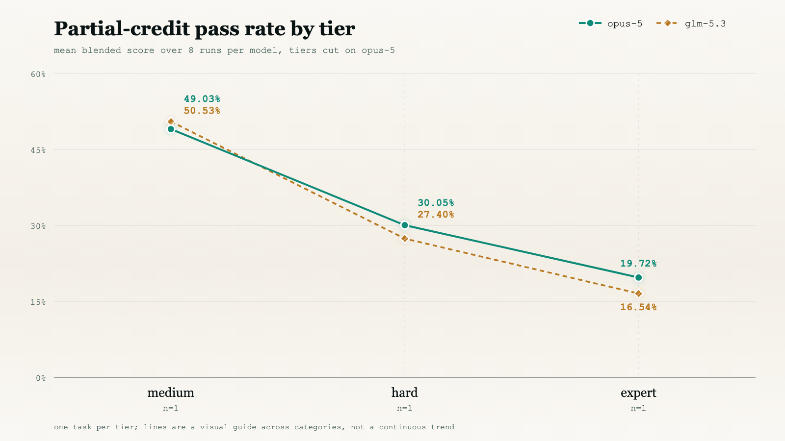
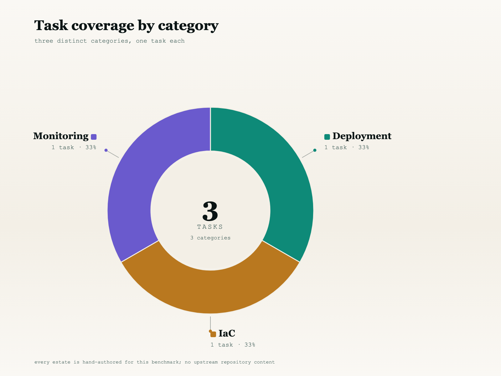
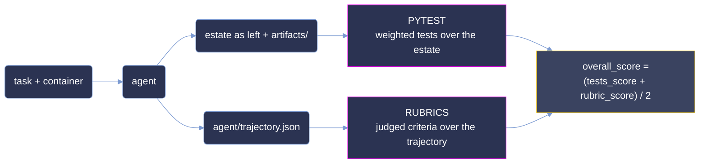

<p align="center">
  <strong>Measuring agentic DevOps capability on hand-authored infrastructure, pipeline and observability faults.</strong>
</p>

<p align="center">
  <a href="#summary"></a>
  <a href="#scoring-methodology"></a>
  <a href="#difficulty-tiers"></a>
  <a href="#reproduction"></a>
</p>

<p align="center"><sub>
  <a href="#summary">Summary</a> · <a href="#repository-layout">Layout</a> · <a href="#difficulty-tiers">Tiers</a> · <a href="#results">Results</a> · <a href="#analysis">Analysis</a> · <a href="#coverage">Coverage</a> · <a href="#dataset-structure">Dataset</a> · <a href="#trajectory-structure">Trajectories</a> · <a href="#scoring-methodology">Scoring</a> · <a href="#reproduction">Reproduction</a> · <a href="#limitations">Limitations</a>
</sub></p>

# KANAO: 3-Task DevOps Evaluation Sample

**KANAO measures agentic DevOps capability on hand-authored faults in Terraform estates,
release pipelines and running service topologies, graded on the estate an agent leaves behind and
on the reasoning it recorded getting there.**

Each task hands an agent a built container holding an original estate with a seeded defect, and a
brief written the way an incident lands on a desk: a symptom, a standard to work to, and the tree.
Nothing is a lookup: the estates were authored for this benchmark rather than mined from a public
repository, so there is no upstream fix to recover, and the reference repair never enters the
agent's environment. Grading reads the estate the agent left - rendered, rebuilt or probed,
depending on the task - and the rubrics grade the recorded trajectory against per-task
criteria.

This sample is narrow and deep: **3 tasks × 2 models × 8 runs = 48 graded rollouts.** The budget goes
on repetition rather than breadth, so difficulty is a measured rate over eight attempts rather than a
single observation. The three tasks are one per tier - one `easy`, one `hard`, one `expert` -
selected so that each occupies a different band of opus-5's measured pass rate, and one per
category - deployment, IaC and monitoring.

**One of the 48 rollouts turned every required test green** - opus-5 on the `easy` deployment task,
run 6, at `overall_score = 1.00`. Every other rollout is a partial result. Strict all-or-nothing
scoring would place 1 / 48 (2.08%) here and would separate almost nothing; throughout this document
**pass rate is the mean `overall_score` over a model's 8 runs on a task**, as a percentage:

```
pass_rate(task, model) = 100 × mean( overall_score over that model's 8 runs on the task )
```
> **This is a curated, quality-controlled sample of the KANAO corpus,** provided for evaluation. The
> dataset format, trajectory format and scoring are identical to the production benchmark.

## Summary

| Property         | Value                                                                       |
| :--------------- | :-------------------------------------------------------------------------- |
| Tasks            | **3**, across 3 distinct categories                                         |
| Models           | `opus-5` and `glm-5.3`                                                       |
| Runs & grid      | 8 per model per task = **48 total**; full 2 × 8 grid, no gaps                |
| Difficulty tiers | Banded on **opus-5**'s mean over 8 runs - one task per tier                  |
| Evaluators       | Three human graders, one per task; each authored the task they grade         |
| Score            | `overall_score` ∈ [0, 1] - the mean of pytest and rubrics, shown as %        |
| Pytest           | Weighted deterministic tests over the delivered estate                       |
| Rubrics          | Judged criteria over the recorded trajectory                                 |
| Environment      | Verifier runs **in a separate container** after the agent's turn ends        |
| Corpus size      | 1,833 files, 292 MB (LFS-deduped; provider binaries share a single blob)     |

| metric | opus-5 | glm-5.3 |
|---|--:|--:|
| **pass rate** (mean `overall_score`) | **45.51%** | 27.93% |
| full-task pass rate (every test green) | 4.17% (1 / 24) | 0% (0 / 24) |
| every-pytest-green rate | 33.33% (8 / 24) | 0% (0 / 24) |
| mean pytest score | **36.81%** | 30.88% |
| mean rubrics score | **54.22%** | 24.98% |
| mean agent cost / run | $3.46 | **$2.11** |
| mean steps / run | **44** | 85 |

## Repository layout

```
kanao-samples/
├── README.md                 # this document
├── LICENSE                   # MIT
├── .gitattributes            # LFS routing for pinned terraform provider binaries
├── images/                   # charts ship in -light and -dark variants, as PNG + SVG source
│   ├── hero.{png,svg}
│   ├── pass_rate_by_tier-{light,dark}.{png,svg}
│   └── tasks_by_category-{light,dark}.{png,svg}
└── <uuid>/                   # one self-contained directory per task (3)
    ├── task.toml, instruction.md, environment/, solution/, tests/
    └── trajectories/
        ├── opus-5/run1 … run8
        └── glm-5.3/run1 … run8
```

## Difficulty tiers

A tier is a **band on a measured rate** - the mean `overall_score` over eight runs:

| band | mean `overall_score` |
|---|---|
| `trivial` | ≥ 87.5% |
| `easy` | [50%, 87.5%) |
| `medium` | [37.5%, 50%) |
| `hard` | [25%, 37.5%) |
| `expert` | < 25% |

| tier | tasks |
|---|--:|
| `easy` | 1 |
| `hard` | 1 |
| `expert` | 1 |

`[metadata].difficulty` is the **only** difficulty label `task.toml` ships, and it is cut on
**opus-5**'s measured rate. That single axis is deliberate: both models are then reported against
the same tier assignment, so a per-tier row is directly comparable across models rather than each
model being graded against its own private banding. Rebanding all three labels from the shipped
scores reproduces all three exactly - see [Reproduction](#reproduction).

No task lands in `trivial`, `medium`, or in a slot below `expert`. opus-5's rate on the `easy` task
sits 3.67 points below the `trivial` boundary; glm-5.3's own rate on the same task sits 0.47 above
the `easy` boundary, and its rate on the `hard` task falls 0.26 below the `hard/expert` boundary
into `expert` on its own reckoning - the [Limitations](#limitations) say what a glm-anchored banding
would change.

## Results

### Partial-credit pass rate by opus-5 tier

| tier | n | opus-5 pass rate | opus-5 pytest | opus-5 cost/run | glm-5.3 pass rate | glm-5.3 pytest | glm-5.3 cost/run |
|---|--:|--:|--:|--:|--:|--:|--:|
| `easy` | 1 | 83.83% | 100.00% | $7.20 | 50.47% | 76.67% | $4.36 |
| `hard` | 1 | 30.84% | 10.42% | $1.48 | 24.74% | 15.97% | $1.22 |
| `expert` | 1 | 21.88% | 0.00% | $1.69 | 8.59% | 0.00% | $0.75 |
| **overall** | **3** | **45.51%** | **36.81%** | **$3.46** | **27.93%** | **30.88%** | **$2.11** |



**Both models fall monotonically across the three tiers.** opus-5 goes 83.83 → 30.84 → 21.88 and
glm-5.3 goes 50.47 → 24.74 → 8.59. Since the tiers were cut on opus-5 alone, its monotonicity is
close to definitional; glm-5.3 reproducing the same ordering on an assignment it had no part in is
the informative half. The two models agree on the ranking of every task, and opus-5 leads on all
three - by 33.36 points on `easy`, 6.10 on `hard`, and 13.29 on `expert` - for a **17.58-point
gap** overall.

**Pytest and rubrics separate the tiers differently.** For opus-5, pytest runs 100.00 → 10.42 → 0.00
and rubrics run 67.65 → 51.25 → 43.75; both fall with the tier, but pytest collapses fastest and
lands at zero on the `expert` task while rubrics still credit 43.75%. For glm-5.3, pytest goes
76.67 → 15.97 → 0.00 and rubrics go 24.26 → 33.50 → 17.19: rubrics **peak on the middle task**
rather than falling with the tier, and the model's overall pass rate on the `easy` task is carried
almost entirely by pytest. Section [Scoring methodology](#scoring-methodology) sets out what pytest
and rubrics each measure, and [Analysis](#analysis) explains why the two disagree.

**Cost does not track difficulty for either model.** opus-5 spends $7.20 → $1.48 → $1.69 as the tier
hardens - non-monotonic, cheapest on `hard`. glm-5.3 spends $4.36 → $1.22 → $0.75 - monotonically
*decreasing* as the tier hardens, the opposite of what "hard costs more" would predict. Cost is a
function of the estate, not of how hard the task is: the `easy` task runs a live release pipeline
that the agent rebuilds repeatedly. Both models spend roughly four to five times the tokens on it
that they spend anywhere else, with the longest trajectories in the sample - glm-5.3 in particular
averages **151 steps** per `easy` run against 46 and 58 on the other two. Across the sample, 48
runs consumed **$133.71** of agent spend, 3,104 steps, 210.84 M input tokens (206.20 M of which are
cache-read hits) and 3.45 M output tokens.

## Analysis

**One outright solve, eight artifact-clean runs, all on the `easy` task, all opus-5.** Run 6 of
opus-5 on `marrowfleet` cleared every pytest item and every rubric criterion for
`overall_score = 1.00`; the other seven opus-5 runs on the same task cleared 100% of pytest but
lost points on rubric. This is the entire "solved" and "tests-green" corpus - glm-5.3 never
delivers a fully-green pytest suite on any task, and no model gets there on `hard` or `expert`.
Even so, the sample is far from saturated: 47 of 48 rollouts are partial results, and the
separation between the models is a partial-credit result end to end.

**Pytest and rubrics catch different failures.** The `expert` task scores 0.00% on tests for both
models, and 43.75% on rubric for opus-5, 17.19% for glm-5.3: every opus-5 run reasoned its way
through the reservation topology to a defensible read of the estate, but the `service:label`
verdict its transcript writes into `/app/verdict.txt` fails the deterministic suite on all 16 runs.
The `hard` task is close to the inverse for glm-5.3 - 15.97% on tests against 33.50% on rubric,
and its one run that passes 66.7% of the Terraform tests (`run6`, on `paymesh`) scores 70.28%
overall. A benchmark that reads only pytest or only rubrics reports one of those two failures
and is blind to the other.

**Eight runs make the label a measurement.** Per-run `overall_score` spans 0.00 to 100.00 across
the sample, and pytest alone spans 0.00 to 100.00. A single rollout could place the same task in
any band: `marrowfleet` alone runs from 20.0% to 75.3% under glm-5.3 and from 70.6% to 100.0%
under opus-5. Averaging eight attempts is what makes `difficulty` a property of the task rather
than a property of the run that happened to be sampled.

**The `expert` task is where the negative detectors earn their weight.** Its suite carries a
detector that fires when any observation the agent cites as evidence fails to match a signed
service response. It fired on **8 of 8** opus-5 runs and **8 of 8** glm-5.3 runs, and it is the
main reason both models' pytest scores on that task sit at 0.00. Both models still clear the
rubric on that task - 43.75% opus-5, 17.19% glm-5.3 - because the judged criteria credit the
comparison and clearance work the transcript shows even when the written verdict does not hold up.

These separations hold because the grading resists gaming. The reference repair never enters the
agent's container; 9 of the 34 pytest items and 11 of the 42 rubric criteria carry negative
weight, so fabricating output, hardcoding around the fault, or editing what the brief placed
off-limits is scored worse than doing nothing; and each task ships its own grader - three
distinct `test_weights.json` digests across three tasks, with no shared template. Recomputing
`overall_score` from pytest and rubrics reproduces all 48 runs.

## Coverage



Three tasks across three distinct categories - Deployment, IaC and Monitoring - with no category
repeated. Graders total **34 pytest items** (25 positive, 9 negative) and **42 rubric criteria**
(31 positive, 11 negative), and the tasks declare **26 artifacts** between them. Per-task grader
size ranges from 9 to 14 pytest items and 9 to 20 rubric criteria. The estates differ in kind: a
Go release pipeline running under Docker Compose, a Terraform tree with its providers mirrored on
disk, and an eight-service Python topology that signs every response. Agent time budgets are
5,400, 9,900 and 3,600 seconds; verifier budgets are 900, 900 and 300 seconds; every image gets
1,800 seconds to build.

### Full task list

| uuid | task | category | pytest (+/−) | rubric (+/−) | opus-5 | glm-5.3 | tier |
|---|---|---|--:|--:|--:|--:|---|
| `58081829` | `ci_repair__marrowfleet-crew-roster` | Deployment | 10 / 4 | 9 / 4 | 83.83% | 50.47% | `easy` |
| `e79449a4` | `iac_guardrails_paymesh-policy` | IaC | 6 / 3 | 16 / 4 | 30.84% | 24.74% | `hard` |
| `8aef516b` | `monitoring__reservation-admission-latency` | Monitoring | 9 / 2 | 6 / 3 | 21.88% | 8.59% | `expert` |

Tier is anchored to opus-5. The `glm-5.3` column is that model's rate on the identical task under
the identical grader, not a re-banding - it is included so the two can be read against one shared
assignment.

## Dataset structure

```
<uuid>/
├── task.toml                 # metadata, difficulty, artifact contract, timeouts, network policy
├── instruction.md            # the prompt the agent receives, verbatim
├── environment/
│   ├── Dockerfile            # the container the agent works inside
│   └── workspace/            # the estate as shipped, with the fault in place
│                             #   marrowfleet adds docker-compose.yaml + src/ (a live pipeline);
│                             #   reservation ships docker-compose.yaml + svc/ + doc/ instead
├── solution/
│   ├── solve.sh              # reference repair - verifier-side only
│   └── TRUTH.md              # defect, root cause, ordered plan, pitfalls
└── tests/
    ├── test.sh               # verifier entrypoint; emits reward.txt, reward.json, ctrf.json
    ├── test_outputs.py       # pytest suite over the delivered estate
    ├── test_weights.json     # per-test weights, positive and negative
    ├── rubric.json           # judged criteria over the trajectory
    ├── score_reward.py       # composes pytest + rubric into overall_score
    ├── Dockerfile            # the verifier's own container
    └── policy-hashes.json    # marrowfleet only: pinned digests of files the agent must not edit
```

The agent sees `instruction.md` and the built container and nothing else. `solution/` and `tests/`
are verifier-side: the reference repair and the answer key never enter the agent's container, which
is what closes the oracle-replay path. `task.toml` carries `schema_version = "1.4"`, the declared
artifact list, `[metadata].difficulty` and `category`, separate agent and verifier timeouts, and
`environment_mode = "separate"` - the verifier runs in its own container once the agent's turn is
over, reading the estate through the declared `artifacts` list rather than sharing the agent's
container.

`network_mode` is `"public"` in all three tasks, and it was used. An audit of all 48 recorded
trajectories finds outbound requests in **3 runs, all glm-5.3**: one `marrowfleet` run installing
packages from PyPI, and two `paymesh` runs fetching documentation from Microsoft Learn and GitHub
(one of them also querying grep.app). No opus-5 run left the estate. The `paymesh` Terraform
providers are mirrored on disk at build time - the `terraform-provider-azurerm_v4.81.0_x5` binary
is tracked in Git LFS and shared across every environment build - so `terraform init` (which every
run on that task issues) resolves without the network. See [Reproduction](#reproduction) for the
audit.

## Trajectory structure

```
<uuid>/trajectories/<model>/
├── pass_summary.json         # per-model roll-up: 8 rows of test/criteria counts and reward
└── run<N>/                   # N ∈ 1…8
    ├── config.json           # agent + verifier configuration for this run
    ├── result.json           # harness envelope: job id, timings, trial stats
    ├── agent/
    │   └── trajectory.json   # ATIF step-by-step record, with final_metrics
    ├── artifacts/
    │   ├── manifest.json     # source → destination map with per-file status
    │   └── …                 # the files task.toml's artifact list declared; paths differ per task
    └── verifier/
        ├── score.json        # tests_score, rubric_score, overall_score, every rubric verdict
        ├── reward.json       # the pytest reward scalar
        ├── ctrf.json         # per-test pass/fail in CTRF form, with weights
        ├── test-stdout.txt   # raw verifier output
        └── usage.json        # tokens and cost for this run
```

`score.json` carries `schema_version` `3`, along with `tests_score`, `rubric_score`, `overall_score`
and a `rubric` block that records the human evaluator's name in `Evaluated By` and every criterion's
verdict with a written justification. `execution` holds the per-test CTRF summary; `summary` restates
the composition formula and the tests/rubric breakdown. `usage.json` reports token and cost
attribution for the agent - `input_tokens`, `output_tokens`, `cache_read_tokens`, `cache_write_tokens`
and `cost_usd` under `sources.agent` - and rubric grading is manual, so no separate `sources.judge`
block is emitted. Every cost figure in this document is summed from `sources.agent.cost_usd`, and
step counts are the length of `agent/trajectory.json`'s `steps` array. Run directories are named
`run1 … run8`; the `run` field inside `score.json` spells the same run `run_1 … run_8`.

`artifacts/` is the delivered estate exactly as the agent left it, collected along the paths
`task.toml` declares, and is what pytest grades. On `reservation`, `ctrf.json` lists a different
number of tests from run to run (11 to 14), because the suite parametrises its phantom-finding
detector over whichever findings the agent actually reported; the eleven weighted names in
`test_weights.json` are fixed.

## Scoring methodology

Pytest and rubrics are computed per run over two different objects. They are averaged into the
headline number with equal weight.



### What "pass rate" means here

`overall_score` reaches `1` on exactly one of the 48 runs; the other 47 are partial. A conventional
strict-pass metric reports 2.08% for opus-5 and 0% for glm-5.3 and ranks almost nothing. Every rate
in this document is instead the partial-credit mean:

```
pass_rate(task, model) = 100 × mean( overall_score over that model's 8 runs on the task )
```

Aggregated as an unweighted mean over runs, then over tasks. It is the same number the bands in
[Difficulty tiers](#difficulty-tiers) are cut on.

### Pytest - the delivered estate

`tests/test.sh` renders the estate the agent left - rebuilding the release on `marrowfleet`,
initialising and validating the tree on `paymesh`, reading the written verdict against signed
service responses on `reservation` - and runs `test_outputs.py` against it. Each test carries a
weight in `test_weights.json`. Across the three tasks there are **34 items: 25 positive, totalling
the achievable score, and 9 negative**. Negative items fire on plausible wrong answers - a file the
brief placed off-limits that was edited, a verifier package that was removed, an observation cited
as evidence that no service ever signed - so guessing scores below silence. The pytest score is
`sum(passed weights) / sum(positive weights)`, clamped at zero. `paymesh` gates before scoring: a
tree that no longer declares its resources or fails `terraform validate` is refused rather than
scored against. The best single run in the corpus reached 100.00%, on `marrowfleet` under opus-5,
and eight of opus-5's eight `marrowfleet` runs cleared 100%.

### Rubrics - the recorded trajectory

`tests/rubric.json` holds **42 criteria** across the three tasks, judged by **three human
evaluators**, one per task, against `agent/trajectory.json` - the recorded reasoning, not the
delivered files. Each criterion is scored independently and carries a weight of `±5`, `±3` or
`±1`; **11 carry negative weight**, penalising over-reach, changing an estate the brief declared
read-only, and citing a value the agent's own transcript contradicts. `verifier/score.json` records
the per-criterion verdict with a justification on every criterion, and the evaluator's name in the
`rubric.Evaluated By` field. The rubrics score is the weighted satisfaction rate. Each evaluator is
one of the co-authors of the task they graded (see `task.toml.[task].authors`); [Limitations](#limitations)
addresses the bias this introduces.

Pytest and rubrics compose with equal weight:

```
overall_score = (tests_score + rubric_score) / 2
```

Verified arithmetically on every run, within the four decimal places the fields ship at - for
example `58081829` opus-5 run 1: (1.0000 + 0.8235) / 2 = 0.9118 to four places.

## Reproduction

Every figure re-derives from the shipped bytes; no re-execution is needed. All snippets are Python
standard library only, run from the repository root - the directory holding this document and the
three task folders.

**Assert the grid is complete, re-derive every tier, and reproduce the headline rates:**

```python
import json, glob, os

BANDS = [(87.5, "trivial"), (50.0, "easy"), (37.5, "medium"), (25.0, "hard")]
def band(x):
    for lo, name in BANDS:
        if x >= lo:
            return name
    return "expert"

tasks = sorted(d for d in os.listdir(".") if os.path.isdir(f"{d}/trajectories"))
assert len(tasks) == 3, tasks

rate, tier = {}, {}
for u in tasks:
    for m in ("opus-5", "glm-5.3"):
        runs = sorted(glob.glob(f"{u}/trajectories/{m}/run*/verifier/score.json"))
        assert len(runs) == 8, (u, m, len(runs))
        rate[(u, m)] = 100 * sum(json.load(open(p))["overall_score"] for p in runs) / 8
    tier[u] = band(rate[(u, "opus-5")])
    declared = open(f"{u}/task.toml").read().split('difficulty = "')[1].split('"')[0]
    assert tier[u] == declared, (u, tier[u], declared)

print(f"grid    3 tasks x 2 models x 8 runs = {len(tasks) * 2 * 8} rollouts")
for u in sorted(tasks, key=lambda u: -rate[(u, "opus-5")]):
    o, g = rate[(u, "opus-5")], rate[(u, "glm-5.3")]
    print(f"  {u[:8]}  {tier[u]:<7} opus-5 {o:6.2f}%   glm-5.3 {g:6.2f}%")
for m, lbl in (("opus-5", "opus-5 "), ("glm-5.3", "glm-5.3")):
    print(f"overall {lbl} {sum(rate[(u, m)] for u in tasks) / 3:6.2f}%")
```

```
grid    3 tasks x 2 models x 8 runs = 48 rollouts
  58081829  easy    opus-5  83.83%   glm-5.3  50.47%
  e79449a4  hard    opus-5  30.84%   glm-5.3  24.74%
  8aef516b  expert  opus-5  21.88%   glm-5.3   8.59%
overall opus-5   45.51%
overall glm-5.3  27.93%
```

**Count outright solves, artifact-clean runs, and the three human evaluators:**

```python
import json, glob
rs = [(p, json.load(open(p))) for p in glob.glob("*/trajectories/*/run*/verifier/score.json")]
evaluators = {}
for p, r in rs:
    ev = r.get("rubric", {}).get("Evaluated By")
    evaluators.setdefault(ev, set()).add(p.split("/")[0][:8])
print({"runs": len(rs),
       "solved": sum(r["overall_score"] >= 1 for _, r in rs),
       "tests_green": sum(r["tests_score"] >= 1 for _, r in rs),
       "evaluators": {e: sorted(ts) for e, ts in evaluators.items()}})
# -> {'runs': 48,
#     'solved': 1,
#     'tests_green': 8,
#     'evaluators': {'riya.jha@ethara.ai': ['58081829'],
#                    'khushi.rathore@ethara.ai': ['e79449a4'],
#                    'vikas.gupta@ethara.ai': ['8aef516b']}}
```

**Re-verify the pytest + rubrics composition on every run.**
All three score fields ship rounded to four decimal places, so the composition is checked at `1e-4`
rather than exactly. The largest deviation across the corpus is `0.00005` - the half-unit rounding
boundary, reached when `(tests + rubric) / 2` lands on a fifth decimal.

```python
import json, glob
ok = worst = 0
for p in glob.glob("*/trajectories/*/run*/verifier/score.json"):
    r = json.load(open(p))
    d = abs((r["tests_score"] + r["rubric_score"]) / 2 - r["overall_score"])
    worst = max(worst, d)
    ok += d < 1e-4
print(f"{ok}/48 ok, worst={worst:.6f}")
# -> 48/48 ok, worst=0.000050
```

**Split the headline rate into pytest and rubrics, per task and model:**

```python
import json, glob, os
for u in sorted(d for d in os.listdir(".") if os.path.isdir(f"{d}/trajectories")):
    for m in ("opus-5", "glm-5.3"):
        rs = [json.load(open(p)) for p in glob.glob(f"{u}/trajectories/{m}/run*/verifier/score.json")]
        t = 100 * sum(r["tests_score"] for r in rs) / 8
        b = 100 * sum(r["rubric_score"] for r in rs) / 8
        print(f"{u[:8]} {m:8} pytest={t:6.2f} rubric={b:6.2f} final={(t + b) / 2:6.2f}")
# -> 58081829 opus-5   pytest=100.00 rubric= 67.65 final= 83.82
# -> 58081829 glm-5.3  pytest= 76.67 rubric= 24.26 final= 50.47
# -> 8aef516b opus-5   pytest=  0.00 rubric= 43.75 final= 21.88
# -> 8aef516b glm-5.3  pytest=  0.00 rubric= 17.19 final=  8.59
# -> e79449a4 opus-5   pytest= 10.42 rubric= 51.25 final= 30.83
# -> e79449a4 glm-5.3  pytest= 15.97 rubric= 33.50 final= 24.74
```

**Sum the agent effort behind the cost figures:**

```python
import json, glob
us = [json.load(open(p)) for p in glob.glob("*/trajectories/*/run*/verifier/usage.json")]
steps = sum(len(json.load(open(p))["steps"]) for p in glob.glob("*/trajectories/*/run*/agent/trajectory.json"))
print({"runs": len(us),
       "agent_usd": round(sum(u["sources"]["agent"]["cost_usd"] for u in us), 2),
       "steps": steps,
       "input_M": round(sum(u["input_tokens"] for u in us) / 1e6, 2),
       "output_M": round(sum(u["output_tokens"] for u in us) / 1e6, 2),
       "cache_read_M": round(sum(u.get("cache_read_tokens", 0) for u in us) / 1e6, 2),
       "cache_write_M": round(sum(u.get("cache_write_tokens", 0) for u in us) / 1e6, 2)})
# -> {'runs': 48, 'agent_usd': 133.71, 'steps': 3104,
#     'input_M': 210.84, 'output_M': 3.45,
#     'cache_read_M': 206.2, 'cache_write_M': 4.57}
```

**Count the graders and confirm each task ships its own:**

```python
import json, glob, hashlib
w = sorted(glob.glob("*/tests/test_weights.json"))
items = [json.load(open(p)) for p in w]
items = [i.get("weights", i) for i in items]
rub = [json.load(open(p)) for p in glob.glob("*/tests/rubric.json")]
print({"tests": sum(len(i) for i in items),
       "tests_negative": sum(1 for i in items for v in i.values() if v < 0),
       "rubric_criteria": sum(len(r) for r in rub),
       "rubric_negative": sum(1 for r in rub for c in r if not c.get("is_positive", True)),
       "distinct_graders": len({hashlib.sha256(open(p, "rb").read()).hexdigest() for p in w})})
# -> {'tests': 34, 'tests_negative': 9, 'rubric_criteria': 42,
#     'rubric_negative': 11, 'distinct_graders': 3}
```

**Audit network use** - every host named in a tool call, minus the estate's own services:

```python
import json, glob, re
estate = {"reservation-worker", "admission-gate", "availability-cache", "synthetic-probe",
          "user-wait-log", "reservation-edge", "inventory", "confirmation", "localhost", "127.0.0.1"}
host = re.compile(r'https?://([^/\s"\'\\):]+)')
used = []
for p in sorted(glob.glob("*/trajectories/*/run*/agent/trajectory.json")):
    hosts = set()
    for s in json.load(open(p)).get("steps", []):
        for call in s.get("tool_calls") or []:
            hosts |= {h for h in host.findall(json.dumps(call))
                      if h not in estate and h[0] not in "${%"}
    if hosts:
        used.append((p.split("/")[0][:8], p.split("/")[2], p.split("/")[3], sorted(hosts)))
print(len(used), "of 48 runs reached a host outside the estate")
for u, m, r, hs in used:
    print(f"  {u} {m} {r}: {', '.join(hs)}")
# -> 3 of 48 runs reached a host outside the estate
# ->   58081829 glm-5.3 run3: files.pythonhosted.org, pypi.org
# ->   e79449a4 glm-5.3 run6: api.github.com, github.com, learn.microsoft.com, raw.githubusercontent.com
# ->   e79449a4 glm-5.3 run7: api.github.com, github.com, grep.app, learn.microsoft.com, raw.githubusercontent.com
```

**Count how often the `expert` task's fabricated-observation detector fired:**

```python
import json, glob
for m in ("opus-5", "glm-5.3"):
    fired = 0
    for p in glob.glob(f"8aef516b-702c-5660-a8f0-da85401c9170/trajectories/{m}/run*/verifier/ctrf.json"):
        fired += any(t["name"] == "test_negative_fabricated_observation" and t["status"] == "failed"
                     for t in json.load(open(p))["results"]["tests"])
    print(f"{m:8} fabricated-observation detector fired on {fired} / 8 runs")
# -> opus-5   fabricated-observation detector fired on 8 / 8 runs
# -> glm-5.3  fabricated-observation detector fired on 8 / 8 runs
```

## Limitations

**Sample size.** Three tasks is a small corpus. Every figure here describes these three tasks under
these two models; none of it estimates the wider corpus, and per-tier rows rest on a single task
each, so a tier row *is* a task row, and a category row is the same row again.

**One solve.** One rollout turned every required test green - opus-5, `marrowfleet`, run 6. The
other 47 are partial results and drive every separation in this document. The corpus can rank the
models on the `easy` and `hard` tasks, and it can rank them on rubric on `expert`, but a benchmark
that a single model saturates in one bucket cannot separate near-solvers from partial-solvers there
- that is what the wider KANAO corpus does.

**Tier anchoring.** Tiers are cut on opus-5 alone. glm-5.3 is reported against an assignment it
had no part in; that is deliberate and makes the rows comparable, but a glm-anchored banding would
move `paymesh` from `hard` to `expert` (24.74% sits below the 25% boundary) and leave the other two
where they are. `marrowfleet` remains in `easy` for glm-5.3 by 0.47 points.

**Human evaluators, self-graded.** The rubric for each task was scored by one human, and each
evaluator is one of the co-authors of the task they graded - Riya Jha graded her own
`marrowfleet`, Khushi Rathore graded her own `paymesh`, Vikas Gupta graded his own `reservation`.
There is one grader per task and no second reader, so evaluator-specific interpretation cannot be
separated from the rubric signal, and the author-as-grader arrangement is a familiarity bias that
tends to reward transcripts framed in terms of the task's own vocabulary. Pytest is unaffected.

**Cost figures.** Costs are the harness's own `cost_usd` accounting, priced from measured token
counts at published list rates, not billed invoices. Neither model was served through a metered
API here, and the token counts - not the dollars - are the measured quantity. Cache-read tokens
dominate the input side (206.20 M of 210.84 M), so the wall-clock and dollar figures are sensitive
to how the harness prices cache reads.

**Network policy.** `network_mode` is `"public"` and was not enforced offline at runtime. Three
glm-5.3 trajectories reached hosts outside the estate; nothing here isolates what, if anything,
the fetches changed about the resulting scores.

## License

MIT © 2026 Ethara.AI - see [LICENSE](LICENSE).

Task content, estates and recorded trajectories are released under the same terms. The estates,
briefs, graders and trajectories in this sample are original work authored for this benchmark; no
upstream repository content is redistributed here.
