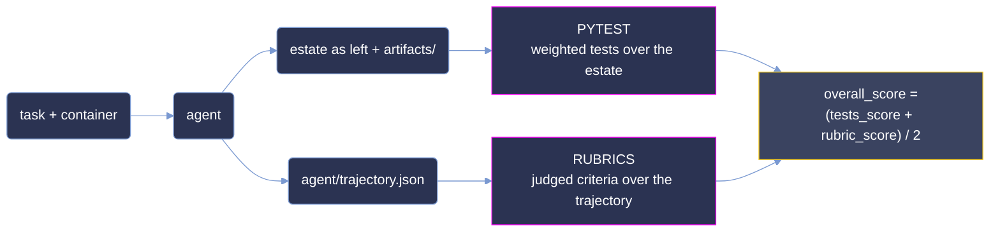

<p align="center">
  <strong>Measuring agentic DevOps capability on hand-authored infrastructure, pipeline and observability faults.</strong>
</p>

<p align="center">
  <a href="#summary"></a>
  <a href="#scoring-methodology"></a>
  <a href="#difficulty-tiers"></a>
  <a href="#reproduction"></a>
</p>

<p align="center"><sub>
  <a href="#summary">Summary</a> · <a href="#repository-layout">Layout</a> · <a href="#difficulty-tiers">Tiers</a> · <a href="#results">Results</a> · <a href="#analysis">Analysis</a> · <a href="#coverage">Coverage</a> · <a href="#dataset-structure">Dataset</a> · <a href="#trajectory-structure">Trajectories</a> · <a href="#scoring-methodology">Scoring</a> · <a href="#reproduction">Reproduction</a> · <a href="#limitations">Limitations</a>
</sub></p>

# KANAO: 3-Task DevOps Evaluation Sample

**KANAO measures agentic DevOps capability on hand-authored faults in Terraform estates,
release pipelines and running service topologies, graded on the estate an agent leaves behind and
on the reasoning it recorded getting there.**

Each task hands an agent a built container holding an original estate with a seeded defect, and a
brief written the way an incident lands on a desk: a symptom, a standard to work to, and the tree.
Nothing is a lookup: the estates were authored for this benchmark rather than mined from a public
repository, so there is no upstream fix to recover, and the reference repair never enters the
agent's environment. Grading reads the estate the agent left - rendered, rebuilt or probed,
depending on the task - and the rubrics grade the recorded trajectory against per-task
criteria.

This sample is narrow and deep: **3 tasks × 2 models × 8 runs = 48 graded rollouts.** The budget goes
on repetition rather than breadth, so difficulty is a measured rate over eight attempts rather than a
single observation. The three tasks are one per tier - one `medium`, one `hard`, one `expert` -
selected so that each occupies a different band of opus-5's measured pass rate, and one per
category - deployment, IaC and monitoring.

**Not one of the 48 rollouts turned every required test green.** Strict all-or-nothing scoring is
therefore `0` everywhere and carries no signal. Throughout this document **pass rate is the mean
`overall_score` over a model's 8 runs on a task**, as a percentage:

```
pass_rate(task, model) = 100 × mean( overall_score over that model's 8 runs on the task )
```
> **This is a curated, quality-controlled sample of the KANAO corpus,** provided for evaluation. The
> dataset format, trajectory format and scoring are identical to the production benchmark.

## Summary

| Property         | Value                                                                       |
| :--------------- | :-------------------------------------------------------------------------- |
| Tasks            | **3**, across 3 distinct categories                                         |
| Models           | `opus-5` and `glm-5.3`                                  |
| Runs & grid      | 8 per model per task = **48 total**; full 2 × 8 grid, no gaps                |
| Difficulty tiers | Banded on **opus-5**'s mean over 8 runs - one task per tier                  |
| Judge            | `gpt-5.6-sol`, sole judge on all 48 runs                                     |
| Score            | `overall_score` ∈ [0, 1] - the mean of pytest and rubrics, shown as %        |
| Pytest           | Weighted deterministic tests over the delivered estate                       |
| Rubrics          | Judged criteria over the recorded trajectory                                 |
| Environment      | Verifier runs **inside the agent's container** after the agent's turn ends   |
| Corpus size      | 1,389 files, 96.3 MB                                                         |

| metric | opus-5 | glm-5.3 |
|---|--:|--:|
| **pass rate** (mean `overall_score`) | **32.93%** | 31.49% |
| full-task pass rate (every test green) | 0% (0 / 24) | 0% (0 / 24) |
| mean pytest score | 19.80% | **23.37%** |
| mean rubrics score | **46.06%** | 39.60% |
| mean agent cost / run | $2.78 | **$1.20** |
| mean steps / run | 41 | **37** |

## Repository layout

```
kanao-samples/
├── README.md                 # this document
├── LICENSE                   # MIT
├── images/                   # charts ship in -light and -dark variants, as PNG + SVG source
│   ├── hero.{png,svg}
│   ├── pass_rate_by_tier-{light,dark}.{png,svg}
│   └── tasks_by_category-{light,dark}.{png,svg}
└── <uuid>/                   # one self-contained directory per task (3)
    ├── task.toml, instruction.md, environment/, solution/, tests/
    └── trajectories/
        ├── opus-5/run1 … run8
        └── glm-5.3/run1 … run8
```

Task directories are named by UUID v5. `task.toml` also carries a human-readable `name`
(`kanao/<slug>`), and this document uses the slug's first word - `marrowfleet`, `paymesh`,
`reservation` - as shorthand for the three tasks.

## Difficulty tiers

A tier is a **band on a measured rate** - the mean `overall_score` over eight runs:

| band | mean `overall_score` |
|---|---|
| `trivial` | ≥ 87.5% |
| `easy` | [50%, 87.5%) |
| `medium` | [37.5%, 50%) |
| `hard` | [25%, 37.5%) |
| `expert` | < 25% |

| tier | tasks |
|---|--:|
| `medium` | 1 |
| `hard` | 1 |
| `expert` | 1 |

`[metadata].difficulty` is the **only** difficulty label `task.toml` ships, and it is cut on
**opus-5**'s measured rate. That single axis is deliberate: both models are then reported against
the same tier assignment, so a per-tier row is directly comparable across models rather than each
model being graded against its own private banding. Rebanding all three labels from the shipped
scores reproduces all three exactly - see [Reproduction](#reproduction).

No task lands in `trivial` or `easy` under opus-5. glm-5.3's own rate on the `medium` task sits
half a point above the `easy` boundary; it is reported here on the opus-5 assignment, and the
[Limitations](#limitations) say what a glm-anchored banding would change.

## Results

### Partial-credit pass rate by opus-5 tier

| tier | n | opus-5 pass rate | opus-5 pytest | opus-5 cost/run | glm-5.3 pass rate | glm-5.3 pytest | glm-5.3 cost/run |
|---|--:|--:|--:|--:|--:|--:|--:|
| `medium` | 1 | 49.03% | 52.00% | $5.66 | 50.53% | 67.50% | $2.51 |
| `hard` | 1 | 30.05% | 0.00% | $0.95 | 27.40% | 0.00% | $0.49 |
| `expert` | 1 | 19.72% | 7.41% | $1.73 | 16.54% | 2.60% | $0.60 |
| **overall** | **3** | **32.93%** | **19.80%** | **$2.78** | **31.49%** | **23.37%** | **$1.20** |


**Both models fall monotonically across the three tiers.** opus-5 goes 49.03 → 30.05 → 19.72 and
glm-5.3 goes 50.53 → 27.40 → 16.54. Since the tiers were cut on opus-5 alone, its monotonicity is
close to definitional; glm-5.3 reproducing the same ordering on an assignment it had no part in is
the informative half. The two models disagree on the `medium` task - glm-5.3 leads it by 1.50 points
- yet glm-5.3 still finishes 1.44 points lower overall, because it gives back more on `hard` and
`expert`.

**Neither pytest nor rubrics follows the tier on its own.** Pytest runs 52.00 → 0.00 → 7.41 for
opus-5: the `hard` task carries the *lowest* artifact score in the corpus - exactly zero on all 16
of its runs - and the `expert` task sits above it. Rubrics run 46.05 → 60.11 → 32.03,
peaking on `hard`. The tier ordering emerges only from their blend. Section
[Scoring methodology](#scoring-methodology) sets out what pytest and rubrics each measure, and
[Analysis](#analysis) explains why the two disagree.

**Cost does not track difficulty for either model.** opus-5 spends $5.66 → $0.95 → $1.73 as the tier
hardens, and glm-5.3 $2.51 → $0.49 → $0.60 - both non-monotonic, both cheapest on the `hard` task.
Cost here is a function of the estate, not of how hard the task is: the `medium` task runs a live
release pipeline that the agent rebuilds repeatedly, and both models spend roughly ten times the
tokens on it that they spend anywhere else, with the longest trajectories in the sample (79 and 68
steps against a corpus mean of 39). Across the sample, 48 runs consumed **$95.52** of agent spend,
1,872 steps, 98.47 M input tokens and 4.40 M output tokens, plus $12.61 of judging.

## Analysis

**Partial credit turns an unsolved corpus into a ranked one.** Zero of 48 rollouts turned every
required test green, so a strict pass/fail metric reports 0% for both models and separates nothing.
The same 48 rollouts under partial credit separate the models by 1.44 points overall and the tasks
by 29.31 points end to end. The signal was always in the runs; binary scoring discards it.

**Pytest and rubrics catch different failures.** The `hard` task scores 0.00% on tests and
60.11% on rubric for opus-5: every run reasoned its way to a defensible account of the policy
estate and none of them delivered a tree that passed the deterministic suite. The `medium` task
inverts the pattern for glm-5.3 - 67.50% on tests against 33.55% on rubric - and it is the one task
glm-5.3 wins. An agent can satisfy a sizeable share of the estate contract while reasoning poorly
about why, and it can reason well about a problem it then fails to implement. A benchmark that reads
only pytest or only rubrics reports one of those two failures and is blind to the other; the ranking flips depending
on which one you pick.

**Eight runs make the label a measurement.** Per-run `overall_score` spans 3.70 to 72.16 across the
sample, and pytest alone spans 0.00 to 88.00. A single rollout could place the same task
in three different bands: `marrowfleet` alone runs from 25.9% to 72.2% under opus-5. Averaging
eight attempts is what makes `difficulty` a property of the task rather than a property of the run
that happened to be sampled.

**The `expert` task is where the negative detectors earn their weight.** Its suite carries a −5
detector that fires when any observation the agent cites as evidence fails to match a signed
service response. It fired on 8 of 8 opus-5 runs and 5 of 8 glm-5.3 runs, and it is the main reason
both models' pytest scores on that task sit below 8%. Both models still clear the rubric at around
30%, because the judged criteria credit the comparison and clearance work the transcript shows even
when the written verdict does not hold up.

These separations hold because the grading resists gaming. The reference repair never enters the
agent's container; 8 of the 27 pytest items and 13 of the 42 rubric criteria carry negative weight,
so fabricating output, hardcoding around the fault, or editing what the brief placed off-limits is
scored worse than doing nothing; and each task ships its own grader - three distinct
`test_weights.json` digests across three tasks, with no shared template. Recomputing
`overall_score` from pytest and rubrics reproduces all 48 runs.

## Coverage


Three tasks across three distinct categories - Deployment, IaC and Monitoring - with no category
repeated. Graders total **27 pytest items** (19 positive, 8 negative) and **42 rubric criteria**
(29 positive, 13 negative), and the tasks declare **38 artifacts** between them. Per-task grader size
ranges from 5 to 11 pytest items and 9 to 18 rubric criteria. The estates differ in kind: a Go
release pipeline running under Docker Compose, a Terraform tree with its providers mirrored on disk,
and an eight-service Python topology that signs every response. Agent time budgets are 5,400, 9,900
and 3,600 seconds; verifier budgets are 900, 900 and 300 seconds; every image gets 1,800 seconds
to build.

### Full task list

| uuid | task | category | pytest (+/−) | rubric | opus-5 | glm-5.3 | tier |
|---|---|---|--:|--:|--:|--:|---|
| `58081829` | `ci_repair__marrowfleet-crew-roster` | Deployment | 7 / 4 | 15 | 49.03% | 50.53% | `medium` |
| `e79449a4` | `iac_guardrails_paymesh-policy` | IaC | 3 / 2 | 18 | 30.05% | 27.40% | `hard` |
| `8aef516b` | `monitoring__reservation-admission-latency` | Monitoring | 9 / 2 | 9 | 19.72% | 16.54% | `expert` |

Tier is anchored to opus-5. The `glm-5.3` column is that model's rate on the identical task under
the identical grader, not a re-banding - it is included so the two can be read against one shared
assignment.

## Dataset structure

```
<uuid>/
├── task.toml                 # metadata, difficulty, artifact contract, timeouts, network policy
├── instruction.md            # the prompt the agent receives, verbatim
├── environment/
│   ├── Dockerfile            # the container the agent works inside
│   └── workspace/            # the estate as shipped, with the fault in place
│                             #   marrowfleet adds docker-compose.yaml + src/ (a live pipeline);
│                             #   reservation ships docker-compose.yaml + svc/ + doc/ instead
├── solution/
│   ├── solve.sh              # reference repair - verifier-side only
│   └── TRUTH.md              # defect, root cause, ordered plan, pitfalls
└── tests/
    ├── test.sh               # verifier entrypoint; emits reward.txt, reward.json, ctrf.json
    ├── test_outputs.py       # pytest suite over the delivered estate
    ├── test_weights.json     # per-test weights, positive and negative
    ├── rubric.json           # judged criteria over the trajectory
    └── policy-hashes.json    # marrowfleet only: pinned digests of files the agent must not edit
```

The agent sees `instruction.md` and the built container and nothing else. `solution/` and `tests/`
are verifier-side: the reference repair and the answer key never enter the agent's container, which
is what closes the oracle-replay path. `task.toml` carries `schema_version = "1.1"`, the declared
artifact list, `[metadata].difficulty` and `category`, separate agent and verifier timeouts, and
`environment_mode = "shared"` - the verifier runs inside the agent's container once the agent's
turn is over, reading the estate exactly as it was left.

`allow_internet` is `true` in all three tasks, and it was used. An audit of all 48 recorded
trajectories finds outbound requests in **3 runs, all glm-5.3**: two `marrowfleet` runs installing
packages from PyPI, and one `paymesh` run fetching documentation from Microsoft Learn and GitHub and
issuing web searches. No opus-5 run left the estate. The `paymesh` Terraform providers are mirrored
on disk at build time, so `terraform init` - which every run on that task issues - resolves without
the network. See [Reproduction](#reproduction) for the audit.

## Trajectory structure

```
<uuid>/trajectories/<model>/
├── pass_summary.json         # per-model roll-up: 8 rows of test/criteria counts and reward
└── run<N>/                   # N ∈ 1…8
    ├── config.json           # agent + verifier configuration for this run
    ├── result.json           # harness envelope: job id, timings, trial stats
    ├── agent/
    │   └── trajectory.json   # ATIF-v1.7 step-by-step record, with final_metrics
    ├── artifacts/
    │   ├── manifest.json     # source → destination map with per-file status
    │   └── …                 # the files task.toml's artifact list declared; paths differ per task
    └── verifier/
        ├── score.json        # tests_score, rubric_score, overall_score, every rubric verdict
        ├── reward.json       # the pytest reward scalar
        ├── ctrf.json         # per-test pass/fail in CTRF form, with weights
        ├── test-stdout.txt   # raw verifier output
        └── usage.json        # tokens and cost, agent and judge kept apart
```

`score.json` carries `tests_score`, `rubric_score`, `overall_score`, the `judge_council` seat, and
one entry per rubric criterion with the judge's vote and justification. `usage.json` attributes
tokens and dollars separately to the agent and to the judge - every cost figure in this document is
summed from its `sources.agent` block, and step counts are the length of `agent/trajectory.json`'s
`steps` array. Run directories are named `run1 … run8`; the `run` field inside `score.json` spells
the same run `run_1 … run_8`.

`artifacts/` is the delivered estate exactly as the agent left it, collected along the paths
`task.toml` declares, and is what pytest grades. On `reservation`, `ctrf.json` lists a
different number of tests from run to run (11 to 14), because the suite parametrises its
phantom-finding detector over whichever findings the agent actually reported; the eleven weighted
names in `test_weights.json` are fixed.

## Scoring methodology

Pytest and rubrics are computed per run over two different objects. They are averaged into the
headline number with equal weight.



### What "pass rate" means here

`overall_score` is `0` under strict all-or-nothing scoring on every one of the 48 runs, so a
conventional pass rate reports 0% for both models and ranks nothing. Every rate in this document is
instead the partial-credit mean:

```
pass_rate(task, model) = 100 × mean( overall_score over that model's 8 runs on the task )
```

Aggregated as an unweighted mean over runs, then over tasks. It is the same number the bands in
[Difficulty tiers](#difficulty-tiers) are cut on.

### Pytest - the delivered estate

`tests/test.sh` renders the estate the agent left - rebuilding the release on `marrowfleet`,
initialising and validating the tree on `paymesh`, reading the written verdict against signed
service responses on `reservation` - and runs `test_outputs.py` against it. Each test carries a
weight in `test_weights.json`. Across the three tasks there are **27 items: 19 positive, totalling
the achievable score, and 8 negative**. Negative items fire on plausible wrong answers - a file the
brief placed off-limits that was edited, a verifier package that was removed, an observation cited
as evidence that no service ever signed - so guessing scores below silence. The pytest score is
`sum(passed weights) / sum(positive weights)`, clamped at zero. `paymesh` gates before scoring: a
tree that no longer declares its resources or fails `terraform validate` is refused rather than
scored against. The best single run in the corpus reached 88.00%, on `marrowfleet` under glm-5.3.

### Rubrics - the recorded trajectory

`tests/rubric.json` holds **42 criteria** across the three tasks, judged by `gpt-5.6-sol` against
`agent/trajectory.json` - the recorded reasoning, not the delivered files - with 14 of them reading
a property of the delivered tree that the deterministic suite does not check. Each criterion is
scored independently and carries a weight of `±5`, `±3` or `±1`; **13 carry negative weight**,
penalising over-reach, changing an estate the brief declared read-only, and citing a value the
agent's own transcript contradicts. `verifier/score.json` records the per-criterion verdict with a
justification on every criterion. The rubrics score is the weighted satisfaction rate. The judge is
`gpt-5.6-sol` on all 48 runs with no fallback and no abstentions across 672 judgments, and judging
consumed 2.40 M input and 0.139 M output tokens.

Pytest and rubrics compose with equal weight:

```
overall_score = (tests_score + rubric_score) / 2
```

Verified arithmetically on every run, within the four decimal places the fields ship at - for
example `58081829` opus-5 run 1: (0.6800 + 0.7632) / 2 = 0.7216 to four places.

## Reproduction

Every figure re-derives from the shipped bytes; no re-execution is needed. All snippets are Python
standard library only, run from the repository root - the directory holding this document and the
three task folders.

**Assert the grid is complete, re-derive every tier, and reproduce the headline rates:**

```python
import json, glob, os

BANDS = [(87.5, "trivial"), (50.0, "easy"), (37.5, "medium"), (25.0, "hard")]
def band(x):
    for lo, name in BANDS:
        if x >= lo:
            return name
    return "expert"

tasks = sorted(d for d in os.listdir(".") if os.path.isdir(f"{d}/trajectories"))
assert len(tasks) == 3, tasks

rate, tier = {}, {}
for u in tasks:
    for m in ("opus-5", "glm-5.3"):
        runs = sorted(glob.glob(f"{u}/trajectories/{m}/run*/verifier/score.json"))
        assert len(runs) == 8, (u, m, len(runs))
        rate[(u, m)] = 100 * sum(json.load(open(p))["overall_score"] for p in runs) / 8
    tier[u] = band(rate[(u, "opus-5")])
    declared = open(f"{u}/task.toml").read().split('difficulty = "')[1].split('"')[0]
    assert tier[u] == declared, (u, tier[u], declared)

print(f"grid    3 tasks x 2 models x 8 runs = {len(tasks) * 2 * 8} rollouts")
for u in sorted(tasks, key=lambda u: -rate[(u, "opus-5")]):
    o, g = rate[(u, "opus-5")], rate[(u, "glm-5.3")]
    print(f"  {u[:8]}  {tier[u]:<7} opus-5 {o:6.2f}%   glm-5.3 {g:6.2f}%")
for m, lbl in (("opus-5", "opus-5 "), ("glm-5.3", "glm-5.3")):
    print(f"overall {lbl} {sum(rate[(u, m)] for u in tasks) / 3:6.2f}%")
```

```
grid    3 tasks x 2 models x 8 runs = 48 rollouts
  58081829  medium  opus-5  49.03%   glm-5.3  50.53%
  e79449a4  hard    opus-5  30.05%   glm-5.3  27.40%
  8aef516b  expert  opus-5  19.72%   glm-5.3  16.54%
overall opus-5   32.93%
overall glm-5.3  31.49%
```

**Confirm no run solved the task outright, and that one judge graded all 48 with no abstention:**

```python
import json, glob
rs = [json.load(open(p)) for p in glob.glob("*/trajectories/*/run*/verifier/score.json")]
print({"runs": len(rs),
       "solved": sum(r["overall_score"] >= 1 for r in rs),
       "tests_green": sum(r["tests_score"] >= 1 for r in rs),
       "judges": sorted({j["model"] for r in rs for c in r["criteria"] for j in c["judges"]}),
       "abstained": sum(r["criteria_abstained"] for r in rs)})
# -> {'runs': 48, 'solved': 0, 'tests_green': 0, 'judges': ['gpt-5.6-sol'], 'abstained': 0}
```

**Re-verify the pytest + rubrics composition on every run.**
All three score fields ship rounded to four decimal places, so the composition is checked at `1e-4`
rather than exactly. The largest deviation across the corpus is `0.00005` - the half-unit rounding
boundary, reached when `(tests + rubric) / 2` lands on a fifth decimal.

```python
import json, glob
ok = worst = 0
for p in glob.glob("*/trajectories/*/run*/verifier/score.json"):
    r = json.load(open(p))
    d = abs((r["tests_score"] + r["rubric_score"]) / 2 - r["overall_score"])
    worst = max(worst, d)
    ok += d < 1e-4
print(f"{ok}/48 ok, worst={worst:.6f}")
# -> 48/48 ok, worst=0.000050
```

**Split the headline rate into pytest and rubrics, per task and model.** The `final` column is
recomputed from the pytest and rubrics means and can sit a hundredth away from the table above, which averages
the stored `overall_score` directly - the same rounding boundary:

```python
import json, glob, os
for u in sorted(d for d in os.listdir(".") if os.path.isdir(f"{d}/trajectories")):
    for m in ("opus-5", "glm-5.3"):
        rs = [json.load(open(p)) for p in glob.glob(f"{u}/trajectories/{m}/run*/verifier/score.json")]
        t = 100 * sum(r["tests_score"] for r in rs) / 8
        b = 100 * sum(r["rubric_score"] for r in rs) / 8
        print(f"{u[:8]} {m:8} pytest={t:6.2f} rubric={b:6.2f} final={(t + b) / 2:6.2f}")
# -> 58081829 opus-5   pytest= 52.00 rubric= 46.05 final= 49.03
# -> 58081829 glm-5.3  pytest= 67.50 rubric= 33.55 final= 50.53
# -> 8aef516b opus-5   pytest=  7.41 rubric= 32.03 final= 19.72
# -> 8aef516b glm-5.3  pytest=  2.60 rubric= 30.47 final= 16.54
# -> e79449a4 opus-5   pytest=  0.00 rubric= 60.11 final= 30.05
# -> e79449a4 glm-5.3  pytest=  0.00 rubric= 54.79 final= 27.39
```

**Sum the agent effort behind the cost figures**, judge kept apart:

```python
import json, glob
us = [json.load(open(p)) for p in glob.glob("*/trajectories/*/run*/verifier/usage.json")]
steps = sum(len(json.load(open(p))["steps"]) for p in glob.glob("*/trajectories/*/run*/agent/trajectory.json"))
print({"runs": len(us),
       "agent_usd": round(sum(u["sources"]["agent"]["cost_usd"] for u in us), 2),
       "judge_usd": round(sum(u["sources"]["judge"]["cost_usd"] for u in us), 2),
       "steps": steps,
       "input_M": round(sum(u["input_tokens"] for u in us) / 1e6, 2),
       "output_M": round(sum(u["output_tokens"] for u in us) / 1e6, 2)})
# -> {'runs': 48, 'agent_usd': 95.52, 'judge_usd': 12.61, 'steps': 1872, 'input_M': 98.47, 'output_M': 4.4}
```

**Count the graders and confirm each task ships its own:**

```python
import json, glob, hashlib
w = sorted(glob.glob("*/tests/test_weights.json"))
items = [json.load(open(p)) for p in w]
items = [i.get("weights", i) for i in items]
rub = [json.load(open(p)) for p in glob.glob("*/tests/rubric.json")]
print({"tests": sum(len(i) for i in items),
       "negative": sum(1 for i in items for v in i.values() if v < 0),
       "rubric_criteria": sum(len(r) for r in rub),
       "rubric_negative": sum(1 for r in rub for c in r if not c["is_positive"]),
       "distinct_graders": len({hashlib.sha256(open(p, "rb").read()).hexdigest() for p in w})})
# -> {'tests': 27, 'negative': 8, 'rubric_criteria': 42, 'rubric_negative': 13, 'distinct_graders': 3}
```

**Audit network use** - every host named in a tool call, minus the estate's own services:

```python
import json, glob, re
estate = {"reservation-worker", "admission-gate", "availability-cache", "synthetic-probe",
          "user-wait-log", "reservation-edge", "inventory", "confirmation", "localhost", "127.0.0.1"}
host = re.compile(r'https?://([^/\s"\'\\):]+)')
used = []
for p in sorted(glob.glob("*/trajectories/*/run*/agent/trajectory.json")):
    hosts = set()
    for s in json.load(open(p))["steps"]:
        for call in s.get("tool_calls") or []:
            hosts |= {h for h in host.findall(json.dumps(call))
                      if h not in estate and h[0] not in "${%"}
    if hosts:
        used.append((p.split("/")[0][:8], p.split("/")[2], p.split("/")[3], sorted(hosts)))
print(len(used), "of 48 runs reached a host outside the estate")
for u, m, r, hs in used:
    print(f"  {u} {m} {r}: {', '.join(hs)}")
# -> 3 of 48 runs reached a host outside the estate
# ->   58081829 glm-5.3 run4: go.dev, pypi.org
# ->   58081829 glm-5.3 run5: files.pythonhosted.org, pypi.org
# ->   e79449a4 glm-5.3 run1: api.github.com, codeload.github.com, github.com, grep.app, html.duckduckgo.com, learn.microsoft.com, raw.githubusercontent.com, www.bing.com, www.google.com
```

**Count how often the `expert` task's fabricated-observation detector fired:**

```python
import json, glob
for m in ("opus-5", "glm-5.3"):
    fired = 0
    for p in glob.glob(f"8aef516b-702c-5660-a8f0-da85401c9170/trajectories/{m}/run*/verifier/ctrf.json"):
        fired += any(t["name"] == "test_negative_fabricated_observation" and t["status"] == "failed"
                     for t in json.load(open(p))["results"]["tests"])
    print(f"{m:8} fabricated-observation detector fired on {fired} / 8 runs")
# -> opus-5   fabricated-observation detector fired on 8 / 8 runs
# -> glm-5.3  fabricated-observation detector fired on 5 / 8 runs
```

## Limitations

**Sample size.** Three tasks is a small corpus. Every figure here describes these three tasks under
these two models; none of it estimates the wider corpus, and per-tier rows rest on a single task
each, so a tier row *is* a task row, and a category row is the same row again.

**Zero solves.** No rollout turned every required test green. The headline separation is entirely a
partial-credit result, and the corpus cannot distinguish a model that nearly solves a task from one
that solves a large fraction of its checks.

**Tier anchoring.** Tiers are cut on opus-5 alone. glm-5.3 is reported against an assignment it had
no part in; that is deliberate and makes the rows comparable, but a glm-anchored banding would place
`marrowfleet` in `easy` (50.53% sits above the 50% boundary) and leave the other two where they are.

**Single judge.** One judge model graded all 48 rubric evaluations with no second opinion and no
inter-rater comparison, so judge-specific bias cannot be separated from the rubric signal. The judge
is also shown the verifier's output alongside the trajectory, so pytest and rubrics are not fully
independent evidence for criteria that restate a deterministic check.

**Cost figures.** Costs are the harness's own `cost_usd` accounting, priced from measured token
counts at published list rates, not billed invoices. Neither model was served through a metered API
here, and the token counts - not the dollars - are the measured quantity.

**Network policy.** `allow_internet` is `true` and was not enforced offline at runtime. Three
glm-5.3 trajectories reached hosts outside the estate, and two of the three scored above that
task's glm-5.3 mean, so the fetches cannot be dismissed as inconsequential; nothing here isolates
what, if anything, they changed.

## License

MIT © 2026 Ethara.AI - see [LICENSE](LICENSE).

Task content, estates and recorded trajectories are released under the same terms. The estates,
briefs, graders and trajectories in this sample are original work authored for this benchmark; no
upstream repository content is redistributed here.
